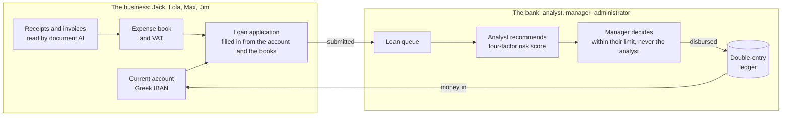
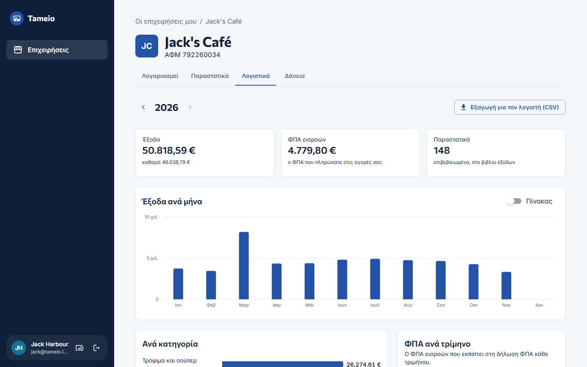
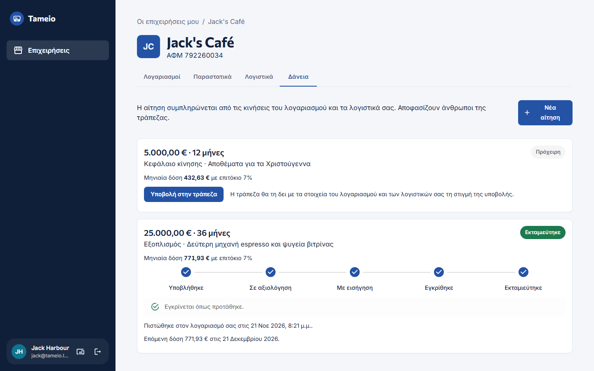
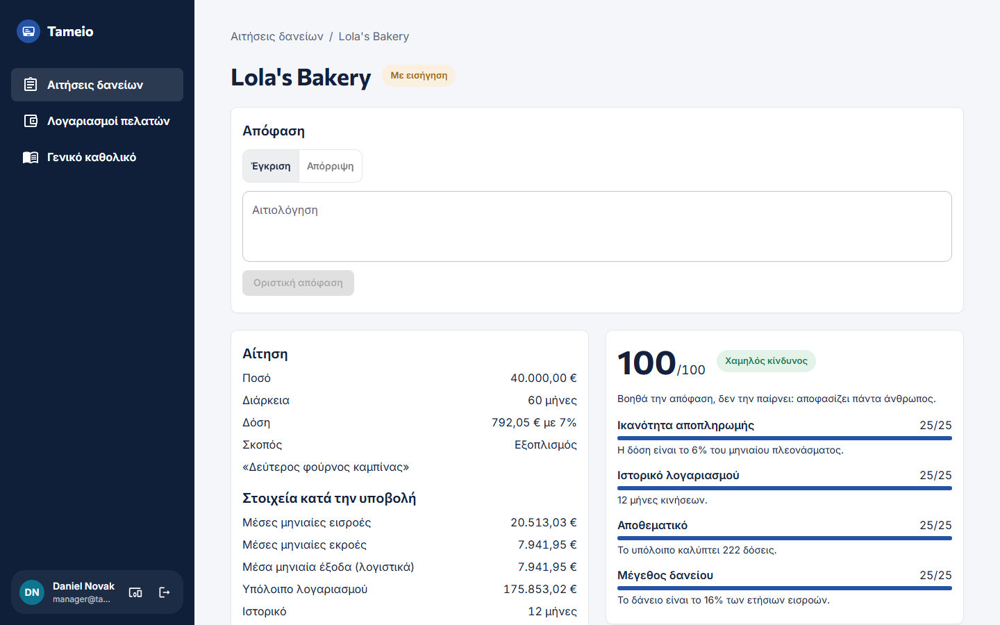
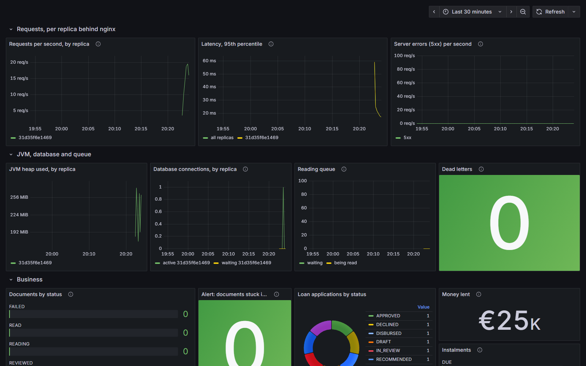
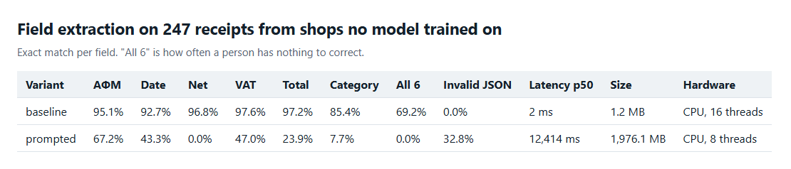
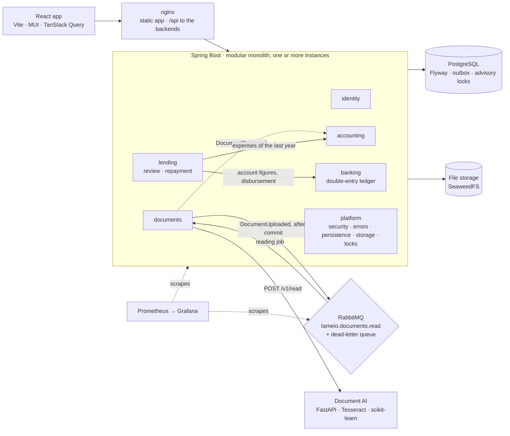

# Tameio

**Tameio is a small, fictional bank for Greek small businesses, with their books built in:** a business keeps
its money here, its receipts are read by AI into an expense book, and it borrows with the figures it has
already verified, while the bank's staff review each loan with four eyes.



Every person, business, account movement and document is invented by the demo data loader; there is no real money.

## See it

| The business: a year of expenses | The business: its loans and the next instalment |
| --- | --- |
|  |  |
| **The bank: a case waiting for the manager** | **Operations: the Grafana dashboard** |
|  |  |



## Run it

With Docker, one command:

```bash
docker compose --profile app up -d --build
```

Open http://localhost:5180. The first start loads **demo data** (about 20 seconds): four businesses with a
year of invented history (takings, rent, suppliers, energy, one big purchase each), their accounts and expense
books. Every figure is made up and every movement goes through the real ledger, so the books balance.

| Sign in as | Password | Sees |
| --- | --- | --- |
| jack@tameio.local | jack123 | Jack Harbour: Jack's Café |
| lola@tameio.local | lola123 | Lola Crumb: Lola's Bakery |
| max@tameio.local | max123 | Max Pixel: Pixel Studio, a design studio |
| jim@tameio.local | jim123 | Jim Merriman: The Grinning Fox Pub, on an island and shut in winter |
| analyst@tameio.local | analyst123 | Sofia Rossi, the back office as a credit analyst |
| manager@tameio.local | manager123 | Daniel Novak, the back office as a credit manager (approves up to 100.000 €) |
| admin@tameio.local | admin123 | Olivia Grant, the back office as administrator: everything, including staff and the general ledger |

You can also create your own account with **Εγγραφή**. To start again from nothing:
`docker compose --profile app down -v` removes the data volumes. Everything runs in containers:
the React app (nginx), the Spring Boot API, document AI (Python), PostgreSQL, RabbitMQ and file storage (SeaweedFS).
The RabbitMQ management UI is at http://localhost:15672 (tameio / tameio), Grafana at http://localhost:3000
(the Tameio dashboard opens by itself; to edit, admin / tameio) and Prometheus at http://localhost:9090.

A ten-minute tour, with who to sign in as and what to click: [docs/demo.md](docs/demo.md).

## What works today

1. **Create an account and sign in.** Passwords are stored as Argon2id hashes. The session is a signed token in an HttpOnly cookie, with CSRF protection; five wrong passwords lock the account for 15 minutes.
2. **Register your business** with its ΑΦΜ, checked against the official check digit. You only ever see your own businesses.
3. **Upload receipts and invoices** (PDF, JPEG or PNG, up to 10 MB), see them in a list and open them. The file type is read from the content, not the name, and the same file cannot be uploaded twice.
4. **Every upload is read by document AI**: OCR, the ΑΦΜ, date, amounts and VAT, checks on them (valid ΑΦΜ, net plus VAT equals the total) and a suggested expense category. The list shows each document's status and what was found; a document that could not be read can be sent again.
5. **Check and confirm each document** on its own page: the file beside what was read, each field marked with how sure document AI was, the checks it ran, and the suggested category. The owner corrects what is wrong and confirms; amounts must add up to the cent. Every correction is stored with the model version as training data, and a document that could not be read can be filled in by hand.
6. **Books and VAT.** Every confirmed document becomes an entry in the expense book. The accounting page shows the year's spending, input VAT and document count, a chart by month (or a table), totals by category, the VAT of each quarter, and the book itself, filterable by category. The accountant gets it as a CSV file that Greek Excel opens as is.
7. **Bank staff and their access.** The bank's staff never sign up: an administrator creates each account with a role (credit analyst, credit manager, administrator) and an approval limit, and hands over a temporary password that must be replaced at first sign-in. Disabling an account, resetting its password, changing its role or "sign out everywhere" ends that person's sessions at once: every request checks the token's session version against the account.
8. **Current accounts on a double-entry ledger.** A business opens accounts with Greek IBANs of Tameio and sees every movement with the balance after it; on a local stack a demo deposit adds money. Every movement is a balanced journal entry: the database refuses unbalanced or altered entries, and the ledger locks accounts in a fixed order so concurrent entries never deadlock or overdraw. Bank staff search customer accounts, freeze them, and see the trial balance, which is always zero ([ADR 0009](docs/adr/0009-core-banking-double-entry-ledger.md)).
9. **Loans with maker-checker.** A business applies for a loan (amount, term, purpose); the application is filled in from its account history and expense book, saved as a draft and submitted when ready. In the back office an analyst takes the case, sees a risk score of four explained factors (repayment capacity, track record, cash cushion, loan size; 25 points each) and recommends with a reason. A manager whose approval limit covers the amount decides, and can never be the person who recommended: the service refuses it and so does a database constraint. An approved loan is paid into the account as one ledger entry. The score helps; a person always decides ([ADR 0010](docs/adr/0010-loan-review-state-machine-and-maker-checker.md)).
10. **Repayment.** A disbursed loan gets a monthly schedule; a nightly job marks each instalment as due once its date has come, and the business sees the next one.
11. **Demo data.** A local stack starts with four businesses, each with a year of invented history in its account and expense book, loan applications in every state, and the bank's staff (see [Run it](#run-it)).

## Stack

| Layer | Choice |
| --- | --- |
| Backend | Java 21, Spring Boot 4, Spring Modulith (event publication registry as outbox), Spring Security (JWT sessions in HttpOnly cookies, CSRF), Spring Data JPA, Spring AMQP |
| Messaging | RabbitMQ 4: quorum work queue for document reading, retries with back-off, dead-letter queue ([ADR 0008](docs/adr/0008-rabbitmq-work-queue-for-document-reading.md)) |
| Database | PostgreSQL 17, schema owned by Flyway (`ddl-auto: validate`); advisory locks for work that must happen once across instances |
| File storage | SeaweedFS, spoken to over the S3 API, so any S3-compatible service works without code changes |
| Frontend | React 19, TypeScript, Vite, MUI, TanStack Query, React Hook Form + Zod, served by nginx |
| Document AI | Python 3.12, FastAPI, Tesseract OCR (Greek), scikit-learn; a comparison with Qwen2.5 prompted and fine-tuned with LoRA |
| Operations | Micrometer, Prometheus, Grafana (provisioned), one alert rule, nginx in front of one or more backends, k6 |
| Tests | JUnit 5, Testcontainers, MockMvc, JaCoCo, Spotless; Vitest, Testing Library, MSW; Playwright; pytest |
| CI | GitHub Actions: backend, frontend, document AI and end-to-end jobs |

## Architecture



- **Modular monolith.** One deployable, split into business modules (`identity`, `documents`, `accounting`, `banking` and `lending`). Spring Modulith tests that a module only uses another module's public API, so a module can later be moved into its own service if it ever needs to be ([ADR 0001](docs/adr/0001-modular-monolith-first.md)).
- **Inside a module:** controller → service → repository. Classes are package-private unless another module needs them. The API never returns JPA entities, only records such as `BusinessView`.
- **`platform`** holds what every module shares: JWT validation and role mapping, RFC 9457 errors, the audited base entity, ΑΦΜ validation, and a `FileStore` interface over S3.
- **Events and the outbox.** `documents` publishes `DocumentUploaded` inside the upload's transaction. Spring Modulith stores it in `event_publication` and sends it to RabbitMQ only after commit, so no job is lost and none is sent for a rolled-back upload. `DocumentReader` takes jobs from the queue (at most 4 at once per instance), calls document AI outside any transaction, retries after 5 s and 15 s if it does not answer, and then marks the document failed and dead-letters the job ([ADR 0008](docs/adr/0008-rabbitmq-work-queue-for-document-reading.md)).
- **Module listeners.** A confirmed document publishes `DocumentReviewed`; `accounting` keeps its expense book with an `@ApplicationModuleListener`, which runs after commit in its own transaction and is retried from the event publication registry if it fails. The two modules share ids, never tables.
- **The ledger.** Only `Ledger` moves money: it locks the accounts an entry touches in id order, applies each signed leg to its balance and stores the entry with its postings. A deferred constraint trigger refuses any entry whose postings do not add up to zero, and triggers make entries and postings append-only.
- **Lombok** is limited to constructors, getters and loggers. `@Data`, setters and generated `equals`/`hashCode` are turned off in `lombok.config`, because they cause bugs in JPA entities.

## Field extraction: rules or an LLM?

Does a small LLM read receipts better than the rules the service uses? The same 247 golden receipts,
from shops none of the models trained on, read three ways: the baseline (regular expressions and TF-IDF),
`Qwen2.5-0.5B-Instruct` with a prompt and one worked example, and the same model fine-tuned with LoRA.

| Variant | ΑΦΜ | Date | Net | VAT | Total | Category | All 6 | Invalid JSON | Latency p50 | Size | Hardware |
|---|---|---|---|---|---|---|---|---|---|---|---|
| baseline | 95.1% | 92.7% | 96.8% | 97.6% | 97.2% | 85.4% | 69.2% | 0.0% | 2 ms | 1.2 MB | CPU, 16 threads |
| prompted | 67.2% | 43.3% | 0.0% | 47.0% | 23.9% | 7.7% | 0.0% | 32.8% | 12,414 ms | 1,976.1 MB | CPU, 8 threads |

The rules win: more accurate on every field, thousands of times faster and smaller, so the LLM is not
connected to the app. The fine-tuned row comes from a free Colab GPU
([notebook](ml/document-ai/notebooks/field_extraction_lora.ipynb)); the data, method, limits and when an LLM
would be worth it are in the [model card](docs/models/field-extraction.md).

```bash
cd ml/document-ai
python -m training.dataset                       # rebuild the versioned dataset (it is committed)
python -m extraction.evaluate --variants baseline # measure; writes results/field-extraction/
pip install -e ".[llm]" && pip install torch --index-url https://download.pytorch.org/whl/cpu
python -m extraction.evaluate --variants prompted # about an hour on a laptop CPU
```

## Several instances

By default one backend runs behind nginx. For a demo with three:

```bash
docker compose --profile app up -d --scale backend=3   # and back with --scale backend=1
```

nginx asks Docker's DNS for the replicas every 10 s and sends requests to them in turn; Prometheus finds them
the same way and scrapes each one. The Grafana dashboard (http://localhost:3000) shows requests, latency and
memory per replica, whether one runs or three, next to the reading queue and the bank's figures: documents by
status, loan applications by status, money lent and instalments. One alert rule, `DocumentsStuckInReading`,
fires when a document has been in READING for more than five minutes
([infra/prometheus/alerts.yml](infra/prometheus/alerts.yml)).

To put some load on it (Docker only):

```bash
docker run --rm -i --network tameio_default -e BASE_URL=http://frontend:5180 grafana/k6:1.1.0 run - < load/k6/browse.js
```

What breaks when the same app runs three times, and how each case is handled:

| With three instances… | How Tameio handles it |
| --- | --- |
| the nightly job that marks instalments as due would run three times | It takes a PostgreSQL advisory lock first (`pg_try_advisory_xact_lock`): one instance does the work, the others skip. The update is idempotent, so a run that comes later changes nothing. |
| all three would load the demo data at the first start | The same kind of lock, but waiting (`pg_advisory_xact_lock`): the first loads, the others wait, then find the data there. The "is it there?" check is inside the lock. |
| all three would migrate the schema at once | Flyway takes its own lock in PostgreSQL; the others wait and find the migrations applied. |
| all three would create the storage bucket at the first start | The one that loses the race gets "already exists" and carries on. (Three replicas found this one: the third crashed.) |
| a user signs in on one instance and the next request lands on another | There is no session in memory: the signed token is in a cookie, and its session version is checked in the database, so any instance accepts it, and signing out everywhere works on all of them. |
| two managers decide the same application on different instances | Optimistic locking (`@Version`): the second gets 409 "changed meanwhile". |
| two entries move money on the same account from different instances | PostgreSQL row locks, taken in id order, so neither overdraws and they never deadlock. |
| a reading job would be done twice | RabbitMQ gives each message to one consumer. A message delivered again, or sent again by an instance that restarts (each one resends events it had not sent), is skipped if the document is already read. |
| an upload would be saved on one instance's disk | Files go to S3 storage, which every instance shares. |
| each instance reports the same business counts | The dashboard takes the maximum across instances, not the sum. |

What is not handled: open-source nginx checks replicas only passively, on real requests, so a replica that
is up but slow keeps getting its share; a new replica takes up to 10 s to receive traffic and 15 s to appear
in Prometheus.

## Work on the code

Requirements: Docker, JDK 21 or newer, Node 22.

```bash
# 1. Infrastructure only: Postgres (5433), file storage (8333), RabbitMQ (5672, UI on 15672), document AI (8090)
docker compose up -d

# 2. Backend on http://localhost:8080, restarts quickly as you change it
cd backend
./mvnw spring-boot:run

# 3. Frontend on http://localhost:5180, reloads in the browser as you save
cd frontend
npm install
npm run dev
```

Then open http://localhost:5180. Useful links while it runs:

- API docs: http://localhost:8080/swagger-ui.html
- Health: http://localhost:8080/actuator/health
- Document AI docs: http://localhost:8090/docs

## Tests

| Level | What it checks | Run it |
| --- | --- | --- |
| Backend unit and API | Domain rules, security, the module structure, every endpoint and the reading pipeline (outbox, queue, retries, dead letters) against real Postgres, RabbitMQ and S3 storage in containers. JaCoCo fails the build below 80% line coverage. | `cd backend && ./mvnw verify` (needs Docker) |
| Frontend components | Forms, pages and error messages in a simulated browser, with the API faked by MSW | `cd frontend && npm test` (`npm run test:coverage` for coverage) |
| Document AI | Field extraction rules, real OCR, and a quality gate: the build fails if the classifier's macro F1 on unseen shops drops. The field-extraction dataset must rebuild byte for byte, and CI measures the baseline against the committed results (the LLMs need a GPU, so their rows come from the committed file). | `cd ml/document-ai && pytest` |
| End to end | The real app in Chromium: sign-up, the API, Postgres and storage. Each test creates its own account. | start the stack and the backend, then `cd frontend && npm run e2e` |
| Load | k6: owners listing documents and an analyst opening loan cases, 10 users for a minute; fails above 1% errors or a p95 of 500 ms for reads | see [Several instances](#several-instances) |

CI runs all four on every push; the end-to-end job starts the whole stack with `docker compose --profile app up --wait`.

## Configuration

The backend reads its settings from environment variables prefixed `TAMEIO_`. The defaults suit local development; the `prod` profile has no defaults for secrets and logs in ECS JSON.

| Variable | Default |
| --- | --- |
| `TAMEIO_DB_URL` | `jdbc:postgresql://localhost:5433/tameio` |
| `TAMEIO_DB_USERNAME` | `tameio` |
| `TAMEIO_DB_PASSWORD` | `tameio` |
| `TAMEIO_JWT_SECRET` | a development-only value; production must set its own (32 bytes or more) |
| `TAMEIO_SECURE_COOKIE` | `false` (production: `true`, cookies over HTTPS only) |
| `TAMEIO_S3_ENDPOINT` | `http://localhost:8333` |
| `TAMEIO_S3_REGION` | `eu-central-1` |
| `TAMEIO_S3_BUCKET` | `tameio-documents` |
| `TAMEIO_S3_ACCESS_KEY` | `tameio` |
| `TAMEIO_S3_SECRET_KEY` | `tameio-dev-secret` |
| `TAMEIO_RABBITMQ_HOST` | `localhost` |
| `TAMEIO_RABBITMQ_PORT` | `5672` |
| `TAMEIO_RABBITMQ_USERNAME` | `tameio` |
| `TAMEIO_RABBITMQ_PASSWORD` | `tameio` |
| `TAMEIO_DOCUMENT_AI_URL` | `http://localhost:8090` |
| `TAMEIO_DEMO_DEPOSITS` | `true` (production: off): businesses can add demo money to their accounts |
| `TAMEIO_DEMO_DATA` | `false` (compose: `true`): load the demo people, businesses and year of history at first start |
| `TAMEIO_BOOTSTRAP_ADMIN_EMAIL` | none: the first administrator, created only while there is none |
| `TAMEIO_BOOTSTRAP_ADMIN_PASSWORD` | none: their temporary password |

## Project layout

```
backend/    Spring Boot app, one package per module (platform, identity, documents, accounting, banking, lending)
frontend/   React app, one folder per feature; nginx.conf puts it in front of the backend
ml/         document-ai: reads receipts and suggests an expense category, and compares its rules
            with a prompted and a fine-tuned LLM (extraction/, notebooks/, results/)
infra/      Prometheus (scrape config, alert), Grafana (data source, dashboard), file storage keys
load/       k6 load test
docs/       Design document, decisions (adr/), model card (models/), demo script, screenshots
```

## Limits

Tameio shows how a bank's systems fit together; it is not one. Compared with a real bank:

- **Instalments are marked due, never collected.** No direct debit, no arrears or late interest, no early
  repayment; every instalment is the same annuity amount, without correcting the last one for rounding.
- **No strong customer authentication or KYC.** Sign-in is a password and a session cookie, with no second
  factor; anyone can register a business, and its ΑΦΜ is checked only by its check digit, not with the tax
  authority. There is no anti-money-laundering screening.
- **No credit bureau.** Nothing is asked of Τειρεσίας or any other register: the risk score sees only what
  the business did at Tameio, and it is a four-factor points table, not a statistical model. One interest
  rate for everyone, no collateral or guarantors.
- **Money only comes in.** Deposits on a local stack stand in for incoming payments; there are no transfers,
  no payments to other banks and no cards. One currency, euro.
- **Invented data.** Document AI learnt from generated receipts, the demo history is generated, and the bank
  code 999 belongs to no bank.
- **One machine.** One database without backups or failover, secrets in the compose file, no audit log of who
  did what.

## How I built this

I designed Tameio and reviewed it throughout: the scope and what to leave out, the module boundaries, the
decisions recorded as ADRs, the data model and every change before it was merged. The code was written with
[Claude Code](https://claude.com/claude-code), Anthropic's coding agent, one phase at a time; each phase
ended with every test green and my review before the next one started. The [design document](docs/design.md)
keeps the plan and the reasons behind it.
