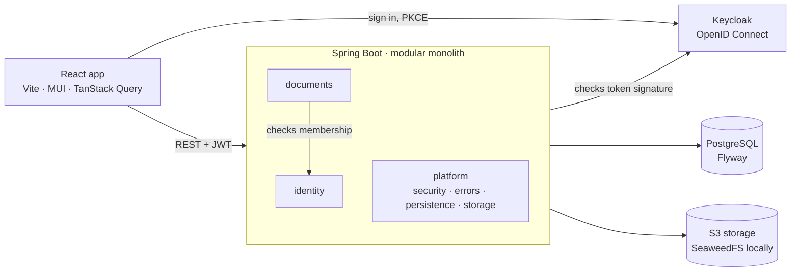

# Tameio

A platform for Greek small businesses. It keeps their books, sends their invoices to myDATA (AADE), and lets them apply for a business loan from a bank (here the fictional **Kyma Bank · demo**).

> Work in progress. Sign-in, business registration and document upload work today. See [docs/design.md](docs/design.md) for the full plan and [docs/adr/](docs/adr/) for the decisions behind it.

## What works today

- Sign in or sign up through Keycloak (OpenID Connect, PKCE)
- Register a business with its ΑΦΜ, checked on both sides with the official check digit
- List only the businesses you belong to; anyone else gets 404, not 403, so the API does not reveal that a business exists
- Upload receipts and invoices (PDF, JPEG, PNG, up to 10 MB) to S3-compatible storage, list them page by page and open them
- The file type is read from the file's first bytes, not from its name; the same file cannot be uploaded twice
- Errors follow RFC 9457 (`application/problem+json`)

## Stack

| Layer | Choice |
| --- | --- |
| Backend | Java 21, Spring Boot 4, Spring Modulith, Spring Security (OAuth2 resource server), Spring Data JPA |
| Database | PostgreSQL 17, schema owned by Flyway (`ddl-auto: validate`) |
| File storage | Any S3-compatible store through the AWS SDK; SeaweedFS locally |
| Identity | Keycloak 26 (realm imported from `infra/keycloak`) |
| Frontend | React 19, TypeScript, Vite, MUI, TanStack Query, React Hook Form + Zod |
| Document AI | Python 3.12, FastAPI, Tesseract OCR (Greek), scikit-learn |
| Tests | JUnit 5, Testcontainers, MockMvc, JaCoCo; Vitest, Testing Library, MSW; Playwright |
| CI | GitHub Actions: backend `verify`, frontend lint + test + build, Playwright end to end |

## Architecture



- **Modular monolith.** One deployable, split into business modules (`identity` and `documents` today, then `accounting`, `mydata`, `lending`, …). Spring Modulith tests that a module only uses another module's public API, so a module can later be moved into its own service if it ever needs to be ([ADR 0001](docs/adr/0001-modular-monolith-first.md)).
- **Inside a module:** controller → service → repository. Classes are package-private unless another module needs them. The API never returns JPA entities, only records such as `BusinessView`.
- **`platform`** holds what every module shares: JWT validation and role mapping, RFC 9457 errors, the audited base entity, ΑΦΜ validation, and a `FileStore` interface over S3.
- **Events.** `documents` publishes `DocumentUploaded`; document AI will start from that event instead of being called directly.
- **Lombok** is limited to constructors, getters and loggers. `@Data`, setters and generated `equals`/`hashCode` are turned off in `lombok.config`, because they cause bugs in JPA entities.

## Run it locally

### Just see the app

Requirements: Docker only.

```bash
docker compose --profile app up -d --build
```

Everything runs in containers: the React app (nginx), the Spring Boot API, document AI (Python),
PostgreSQL, Keycloak and S3 storage.

### Work on the code

Requirements: Docker, JDK 21 or newer, Node 22.

```bash
# 1. Infrastructure only: Postgres (5433), Keycloak (8180), S3 storage (8333), document AI (8090)
docker compose up -d

# 2. Backend on http://localhost:8080, restarts quickly as you change it
cd backend
./mvnw spring-boot:run

# 3. Frontend on http://localhost:5180, reloads in the browser as you save
cd frontend
npm install
npm run dev
```

Open http://localhost:5180 and sign in with a demo user:

| User | Password | Role |
| --- | --- | --- |
| `maria` | `maria` | Business owner |
| `giorgos` | `giorgos` | Bank analyst (cannot reach the business API) |

These users exist only in the local dev realm.

Useful links while it runs:

- API docs: http://localhost:8080/swagger-ui.html
- Health: http://localhost:8080/actuator/health
- Keycloak admin: http://localhost:8180 (admin / admin)
- Document AI docs: http://localhost:8090/docs

## Tests

| Level | What it checks | Run it |
| --- | --- | --- |
| Backend unit and API | Domain rules, security, the module structure, every endpoint against real Postgres and S3 storage in containers. JaCoCo fails the build below 80% line coverage. | `cd backend && ./mvnw verify` (needs Docker) |
| Frontend components | Forms, pages and error messages in a simulated browser, with the API faked by MSW | `cd frontend && npm test` (`npm run test:coverage` for coverage) |
| Document AI | Field extraction rules, real OCR, and a quality gate: the build fails if the classifier's macro F1 on unseen shops drops | `cd ml/document-ai && pytest` |
| End to end | The real app in Chromium through Keycloak, the API, Postgres and storage | start the stack and the backend, then `cd frontend && npm run e2e` |

CI runs all three on every push; the end-to-end job starts the whole stack with `docker compose up --wait`.

## Configuration

The backend reads its settings from environment variables prefixed `TAMEIO_`. The defaults suit local development; the `prod` profile has no defaults for secrets and logs in ECS JSON.

| Variable | Default |
| --- | --- |
| `TAMEIO_DB_URL` | `jdbc:postgresql://localhost:5433/tameio` |
| `TAMEIO_DB_USERNAME` | `tameio` |
| `TAMEIO_DB_PASSWORD` | `tameio` |
| `TAMEIO_KEYCLOAK_ISSUER` | `http://localhost:8180/realms/tameio` |
| `TAMEIO_S3_ENDPOINT` | `http://localhost:8333` |
| `TAMEIO_S3_REGION` | `eu-central-1` |
| `TAMEIO_S3_BUCKET` | `tameio-documents` |
| `TAMEIO_S3_ACCESS_KEY` | `tameio` |
| `TAMEIO_S3_SECRET_KEY` | `tameio-dev-secret` |

## Project layout

```
backend/    Spring Boot app, one package per module (platform, identity, documents, ...)
ml/         Python services; document-ai reads receipts and suggests an expense category
frontend/   React app, one folder per feature
infra/      Keycloak realm, S3 storage identities and, later, the rest of the local infrastructure
docs/       Design document and architecture decision records
```
