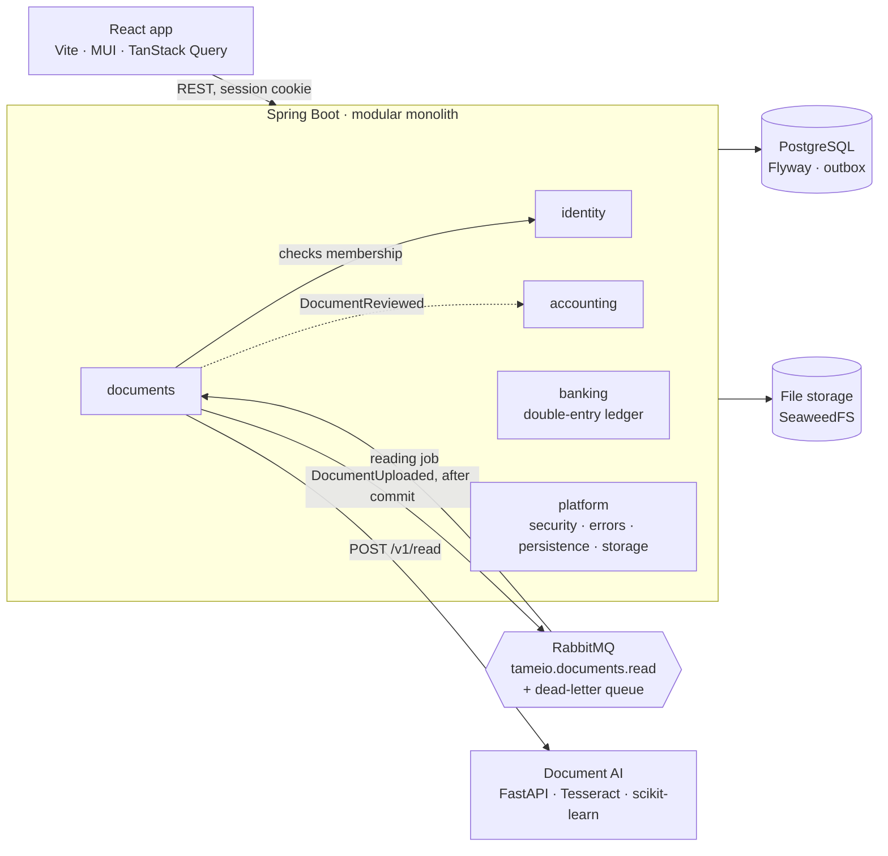

# Tameio

A small bank for Greek small businesses, with their books built in. A business holds its money in current accounts with Greek IBANs, uploads receipts that AI reads into an expense book, and (next) borrows with the figures it has already verified. Tameio is itself the bank: a fictional one. Every person, business, movement and document comes from the demo data loader; there is no real money.

> Work in progress. The plan is in [docs/design.md](docs/design.md), the decisions behind it in [docs/adr/](docs/adr/).

## What works today

1. **Create an account and sign in.** Passwords are stored as Argon2id hashes. The session is a signed token in an HttpOnly cookie, with CSRF protection; five wrong passwords lock the account for 15 minutes.
2. **Register your business** with its ΑΦΜ, checked against the official check digit. You only ever see your own businesses.
3. **Upload receipts and invoices** (PDF, JPEG or PNG, up to 10 MB), see them in a list and open them. The file type is read from the content, not the name, and the same file cannot be uploaded twice.
4. **Every upload is read by document AI**: OCR, the ΑΦΜ, date, amounts and VAT, checks on them (valid ΑΦΜ, net plus VAT equals the total) and a suggested expense category. The list shows each document's status and what was found; a document that could not be read can be sent again.
5. **Check and confirm each document** on its own page: the file beside what was read, each field marked with how sure document AI was, the checks it ran, and the suggested category. The owner corrects what is wrong and confirms; amounts must add up to the cent. Every correction is stored with the model version as training data, and a document that could not be read can be filled in by hand.
6. **Books and VAT.** Every confirmed document becomes an entry in the expense book. The accounting page shows the year's spending, input VAT and document count, a chart by month (or a table), totals by category, the VAT of each quarter, and the book itself, filterable by category. The accountant gets it as a CSV file that Greek Excel opens as is.
7. **Bank staff and their access.** The bank's staff never sign up: an administrator creates each account with a role (credit analyst, credit manager, administrator) and an approval limit, and hands over a temporary password that must be replaced at first sign-in. Disabling an account, resetting its password, changing its role or "sign out everywhere" ends that person's sessions at once: every request checks the token's session version against the account.
8. **Current accounts on a double-entry ledger.** A business opens accounts with Greek IBANs of Tameio and sees every movement with the balance after it; on a local stack a demo deposit adds money. Every movement is a balanced journal entry: the database refuses unbalanced or altered entries, and the ledger locks accounts in a fixed order so concurrent entries never deadlock or overdraw. Bank staff search customer accounts, freeze them, and see the trial balance, which is always zero ([ADR 0009](docs/adr/0009-core-banking-double-entry-ledger.md)).
9. **Loans with maker-checker.** A business applies for a loan (amount, term, purpose); the application is filled in from its account history and expense book, saved as a draft and submitted when ready. In the back office an analyst takes the case, sees a risk score of four explained factors (repayment capacity, track record, cash cushion, loan size; 25 points each) and recommends with a reason. A manager whose approval limit covers the amount decides, and can never be the person who recommended: the service refuses it and so does a database constraint. An approved loan is paid into the account as one ledger entry. The score helps; a person always decides ([ADR 0011](docs/adr/0011-loan-review-state-machine-and-maker-checker.md)).
10. **Demo data.** A local stack starts with four businesses and a year of invented history in their accounts and expense books, loan applications in every state, plus demo staff (see below).

Payments between accounts and to other banks were built and then withdrawn to keep the project focused; the code is at the git tag `with-payments` ([ADR 0010](docs/adr/0010-sepa-payments-through-a-clearing-house-over-rabbitmq.md)).

Coming next: an append-only audit log, then observability and several instances behind a load balancer ([docs/design.md](docs/design.md#12-delivery-plan)).

## Stack

| Layer | Choice |
| --- | --- |
| Backend | Java 21, Spring Boot 4, Spring Modulith (event publication registry as outbox), Spring Security (JWT sessions in HttpOnly cookies, CSRF), Spring Data JPA, Spring AMQP |
| Messaging | RabbitMQ 4: quorum work queue for document reading, retries with back-off, dead-letter queue ([ADR 0008](docs/adr/0008-rabbitmq-work-queue-for-document-reading.md)); no Kafka |
| Database | PostgreSQL 17, schema owned by Flyway (`ddl-auto: validate`) |
| File storage | SeaweedFS in a container. The code talks to it with the standard S3 protocol, so production can use any S3-compatible service without code changes |
| Frontend | React 19, TypeScript, Vite, MUI, TanStack Query, React Hook Form + Zod |
| Document AI | Python 3.12, FastAPI, Tesseract OCR (Greek), scikit-learn |
| Tests | JUnit 5, Testcontainers, MockMvc, JaCoCo; Vitest, Testing Library, MSW; Playwright |
| CI | GitHub Actions: backend, frontend, document AI and end-to-end jobs |

## Architecture



- **Modular monolith.** One deployable, split into business modules (`identity`, `documents`, `accounting`, `banking` and `lending` today, then `audit`). Spring Modulith tests that a module only uses another module's public API, so a module can later be moved into its own service if it ever needs to be ([ADR 0001](docs/adr/0001-modular-monolith-first.md)).
- **Inside a module:** controller → service → repository. Classes are package-private unless another module needs them. The API never returns JPA entities, only records such as `BusinessView`.
- **`platform`** holds what every module shares: JWT validation and role mapping, RFC 9457 errors, the audited base entity, ΑΦΜ validation, and a `FileStore` interface over S3.
- **Events and the outbox.** `documents` publishes `DocumentUploaded` inside the upload's transaction. Spring Modulith stores it in `event_publication` and sends it to RabbitMQ only after commit, so no job is lost and none is sent for a rolled-back upload. `DocumentReader` takes jobs from the queue (at most 4 at once per instance), calls document AI outside any transaction, retries after 5 s and 15 s if it does not answer, and then marks the document failed and dead-letters the job ([ADR 0008](docs/adr/0008-rabbitmq-work-queue-for-document-reading.md)).
- **Module listeners.** A confirmed document publishes `DocumentReviewed`; `accounting` keeps its expense book with an `@ApplicationModuleListener`, which runs after commit in its own transaction and is retried from the event publication registry if it fails. The two modules share ids, never tables.
- **The ledger.** Only `Ledger` moves money: it locks the accounts an entry touches in id order, applies each signed leg to its balance and stores the entry with its postings. A deferred constraint trigger refuses any entry whose postings do not add up to zero, and triggers make entries and postings append-only.
- **Lombok** is limited to constructors, getters and loggers. `@Data`, setters and generated `equals`/`hashCode` are turned off in `lombok.config`, because they cause bugs in JPA entities.

## Run it locally

### Just see the app

Requirements: Docker only.

```bash
docker compose --profile app up -d --build
```

Open http://localhost:5180. The first start loads **demo data** (about 20 seconds): four businesses with a
year of invented history (takings, rent, suppliers, energy, one big purchase each), their accounts and expense
books. Every figure is made up and every movement goes through the real ledger, so the books balance.

| Sign in as | Password | Sees |
| --- | --- | --- |
| demo@tameio.local | demo-password-2026 | Emma Collins: Καφέ Το Στέκι, Αρτοποιία Αιγαίο, Studio Λευκό |
| lucas@tameio.local | demo-password-2026 | Lucas Meyer: Ταβέρνα Ο Γιάννης (an island taverna, shut in winter) |
| manager@tameio.local | demo-staff-password-2026 | Daniel Novak, the back office as a credit manager (approves up to 100.000 €) |
| analyst@tameio.local | demo-staff-password-2026 | Sofia Rossi, the back office as a credit analyst |
| admin@tameio.local | demo-staff-password-2026 | Olivia Grant, the back office as administrator: everything, including staff and the general ledger |

You can also create your own account with **Εγγραφή**. To start again from nothing:
`docker compose --profile app down -v` removes the data volumes. Everything runs in containers:
the React app (nginx), the Spring Boot API, document AI (Python), PostgreSQL, RabbitMQ and file storage (SeaweedFS).
The RabbitMQ management UI is at http://localhost:15672 (tameio / tameio).
There are no ready-made accounts or sample data.

### Work on the code

Requirements: Docker, JDK 21 or newer, Node 22.

```bash
# 1. Infrastructure only: Postgres (5433), file storage (8333), RabbitMQ (5672, UI on 15672), document AI (8090)
docker compose up -d

# 2. Backend on http://localhost:8080, restarts quickly as you change it
cd backend
./mvnw spring-boot:run

# 3. Frontend on http://localhost:5180, reloads in the browser as you save
cd frontend
npm install
npm run dev
```

Then open http://localhost:5180. Useful links while it runs:

- API docs: http://localhost:8080/swagger-ui.html
- Health: http://localhost:8080/actuator/health
- Document AI docs: http://localhost:8090/docs

## Tests

| Level | What it checks | Run it |
| --- | --- | --- |
| Backend unit and API | Domain rules, security, the module structure, every endpoint and the reading pipeline (outbox, queue, retries, dead letters) against real Postgres, RabbitMQ and S3 storage in containers. JaCoCo fails the build below 80% line coverage. | `cd backend && ./mvnw verify` (needs Docker) |
| Frontend components | Forms, pages and error messages in a simulated browser, with the API faked by MSW | `cd frontend && npm test` (`npm run test:coverage` for coverage) |
| Document AI | Field extraction rules, real OCR, and a quality gate: the build fails if the classifier's macro F1 on unseen shops drops | `cd ml/document-ai && pytest` |
| End to end | The real app in Chromium: sign-up, the API, Postgres and storage. Each test creates its own account. | start the stack and the backend, then `cd frontend && npm run e2e` |

CI runs all four on every push; the end-to-end job starts the whole stack with `docker compose --profile app up --wait`.

## Configuration

The backend reads its settings from environment variables prefixed `TAMEIO_`. The defaults suit local development; the `prod` profile has no defaults for secrets and logs in ECS JSON.

| Variable | Default |
| --- | --- |
| `TAMEIO_DB_URL` | `jdbc:postgresql://localhost:5433/tameio` |
| `TAMEIO_DB_USERNAME` | `tameio` |
| `TAMEIO_DB_PASSWORD` | `tameio` |
| `TAMEIO_JWT_SECRET` | a development-only value; production must set its own (32 bytes or more) |
| `TAMEIO_SECURE_COOKIE` | `false` (production: `true`, cookies over HTTPS only) |
| `TAMEIO_S3_ENDPOINT` | `http://localhost:8333` |
| `TAMEIO_S3_REGION` | `eu-central-1` |
| `TAMEIO_S3_BUCKET` | `tameio-documents` |
| `TAMEIO_S3_ACCESS_KEY` | `tameio` |
| `TAMEIO_S3_SECRET_KEY` | `tameio-dev-secret` |
| `TAMEIO_RABBITMQ_HOST` | `localhost` |
| `TAMEIO_RABBITMQ_PORT` | `5672` |
| `TAMEIO_RABBITMQ_USERNAME` | `tameio` |
| `TAMEIO_RABBITMQ_PASSWORD` | `tameio` |
| `TAMEIO_DOCUMENT_AI_URL` | `http://localhost:8090` |
| `TAMEIO_DEMO_DEPOSITS` | `true` (production: off): businesses can add demo money to their accounts |
| `TAMEIO_DEMO_DATA` | `false` (compose: `true`): load the demo people, businesses and year of history at first start |
| `TAMEIO_BOOTSTRAP_ADMIN_EMAIL` | none: the first administrator, created only while there is none |
| `TAMEIO_BOOTSTRAP_ADMIN_PASSWORD` | none: their temporary password |

## Project layout

```
backend/    Spring Boot app, one package per module (platform, identity, documents, ...)
ml/         Python services; document-ai reads receipts and suggests an expense category
frontend/   React app, one folder per feature
infra/      Local infrastructure settings (file storage access keys)
docs/       Design document and architecture decision records
```
