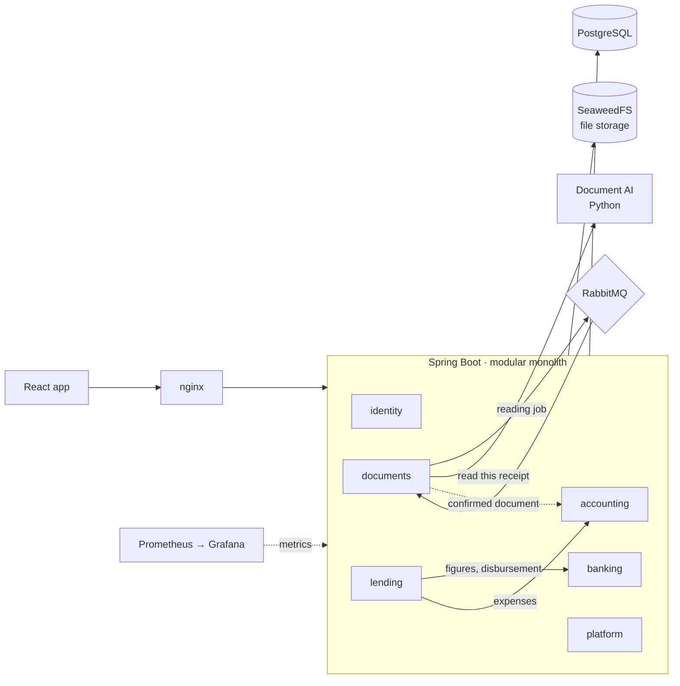

# Tameio

**A small, fictional bank for Greek small businesses, with their books built in.** A business keeps its money
here, its receipts are read by AI into an expense book, and it applies for loans with figures the bank already
has. The bank's staff review each loan: an analyst recommends, a manager decides.

All people, businesses, movements and documents are invented by the demo data loader; there is no real money.

| The business: a year of expenses | The bank: a loan case waiting for the manager |
| --- | --- |
|  |  |

## What it does

**For the business**
- **Current account** with a Greek IBAN, every movement and the balance after it.
- **Receipts and invoices** (PDF, JPEG, PNG) are uploaded and read by document AI: OCR, ΑΦΜ, date, amounts,
  VAT and a suggested expense category. The owner checks what was read, corrects it and confirms.
- **Expense book and VAT**: every confirmed document becomes an entry. Spending by month and category, VAT by
  quarter, and a CSV export for the accountant.
- **Loan application**, filled in from the account history and the expense book. After the loan is paid out,
  the business sees its monthly instalments.

**For the bank**
- **Loan review with four eyes**: an analyst takes the case, sees a risk score of four factors and
  recommends; a manager decides within their approval limit, and can never be the person who recommended.
  An approved loan is paid into the business's account.
- **Back office**: search customer accounts, freeze them, see the general ledger and its trial balance.
- **Staff management**: an administrator creates staff accounts with a role and an approval limit.

## Architecture



**How a request travels.** The browser loads the React app from nginx. Every call to `/api` goes through nginx
to the Spring Boot backend, which checks the session cookie, runs the business rules and reads or writes
PostgreSQL.

**The backend is a modular monolith**: one application, split into modules by business area. Each module
owns its tables and exposes a small public API; a test (Spring Modulith) fails the build if one module
reaches into another's internals.

| Module | What it owns |
| --- | --- |
| `identity` | Users, sign-in, businesses, bank staff and roles |
| `documents` | Uploaded receipts, their reading and the owner's review |
| `accounting` | The expense book and VAT |
| `banking` | Accounts and the double-entry ledger: the only place money moves |
| `lending` | Loan applications, risk score, review, disbursement and instalments |
| `platform` | What all modules share: security, errors, file storage, database locks |

**Modules talk through events.** When a document is uploaded, `documents` publishes an event in the same
database transaction. Spring Modulith stores it (the outbox) and sends it to RabbitMQ only after the commit,
so no job is lost. A worker takes the job from the queue, sends the file to document AI and saves what it
read; if document AI does not answer, the job is retried and finally moved to a dead-letter queue. When the
owner confirms a document, `accounting` hears about it and adds the entry to the expense book.

**Money moves only through the ledger.** Every movement is a journal entry whose legs add up to zero; the
database refuses unbalanced or altered entries, and accounts are locked in a fixed order so two movements at
once never overdraw or deadlock.

**Several instances.** The backend keeps no session in memory (the session is a signed token in a cookie), so
any number of instances can run behind nginx. Work that must happen once, such as the nightly job that marks
instalments as due, takes a PostgreSQL advisory lock first.

## Stack

| Part | Technology | Used for |
| --- | --- | --- |
| Backend | Java 21, Spring Boot 4, Spring Modulith, Spring Security, Spring Data JPA, Flyway | The API and all business rules |
| Database | PostgreSQL 17 | All data; the schema is versioned with Flyway |
| Messaging | RabbitMQ 4 | The queue of documents waiting to be read, with retries and a dead-letter queue |
| File storage | SeaweedFS (S3 API) | The uploaded files |
| Frontend | React 19, TypeScript, Vite, MUI, TanStack Query, React Hook Form + Zod | The screens for businesses and bank staff |
| Web server | nginx | Serves the React app and forwards `/api` to the backend |
| Document AI | Python, FastAPI, Tesseract OCR, scikit-learn | Reads receipts and suggests an expense category |
| Monitoring | Micrometer, Prometheus, Grafana | Requests, latency, memory, the reading queue and the bank's figures |
| Tests | JUnit 5, Testcontainers, Vitest, Testing Library, Playwright, pytest, k6 | Unit, API, end-to-end and load tests |
| CI | GitHub Actions | Runs every test on every push |

## Run it

With Docker:

```bash
docker compose --profile app up -d --build
```

Open http://localhost:5180. The first start loads the demo data (about 20 seconds): four businesses with a
year of history, and the bank's staff.

| Sign in as | Password | Who |
| --- | --- | --- |
| jack@tameio.local | jack123 | Jack's Café |
| lola@tameio.local | lola123 | Lola's Bakery |
| max@tameio.local | max123 | Pixel Studio |
| jim@tameio.local | jim123 | The Grinning Fox Pub |
| analyst@tameio.local | analyst123 | Credit analyst: recommends |
| manager@tameio.local | manager123 | Credit manager: decides, up to 100.000 € |
| admin@tameio.local | admin123 | Administrator: staff and the general ledger |

| Also running | Address |
| --- | --- |
| Grafana dashboard | http://localhost:3000 |
| Prometheus | http://localhost:9090 |
| RabbitMQ management | http://localhost:15672 (tameio / tameio) |
| API docs (Swagger) | http://localhost:8080/swagger-ui.html when the backend runs outside Docker |

`docker compose --profile app down -v` stops everything and deletes the data. A ten-minute tour of what to
click: [docs/demo.md](docs/demo.md).

## Document AI: rules or an LLM?

The service reads receipts with rules (regular expressions) and a small classifier. To see whether a
language model would do better, the same 247 receipts, from shops none of the models saw, were read three
ways: the rules, `Qwen2.5-0.5B-Instruct` with a prompt, and the same model fine-tuned with LoRA.

| Variant | ΑΦΜ | Date | Net | VAT | Total | Category | All 6 | Invalid JSON | Latency p50 |
|---|---|---|---|---|---|---|---|---|---|
| rules (baseline) | 95.1% | 92.7% | 96.8% | 97.6% | 97.2% | 85.4% | 69.2% | 0.0% | 2 ms |
| prompted LLM | 66.8% | 43.3% | 0.0% | 46.6% | 24.3% | 7.7% | 0.0% | 33.2% | 1,930 ms (GPU) |
| fine-tuned LLM | 98.8% | 97.2% | 90.7% | 98.0% | 98.0% | 44.5% | 37.2% | 1.2% | 1,952 ms (GPU) |

Fine-tuning taught the model the format, and it reads the ΑΦΜ, date, VAT and total better than the rules.
It gets the category of shops it has not seen and the net amount (a subtraction) wrong too often, so all six
fields are right less often than with the rules, which also run a thousand times faster on a CPU. The app
uses the rules. The method, the data and an analysis of the mistakes are in the
[model card](docs/models/field-extraction.md); the fine-tuning ran on a free Colab GPU
([notebook](ml/document-ai/notebooks/field_extraction_lora.ipynb)).

## Tests

```bash
cd backend && ./mvnw verify          # unit and API tests against real Postgres, RabbitMQ and S3 in containers
cd frontend && npm test              # components, with the API faked
cd frontend && npm run e2e           # the real app in Chromium (stack running)
cd ml/document-ai && pytest          # extraction rules, OCR and the classifier's quality gate
```

## Project layout

```
backend/    Spring Boot app, one package per module
frontend/   React app, one folder per feature, and nginx.conf
ml/         Document AI service, dataset and the rules-vs-LLM comparison
infra/      Prometheus and Grafana configuration
load/       k6 load test
docs/       Design document, architecture decisions (adr/), model card, demo script
```

## How I built this

I designed Tameio and reviewed every change; the code was written with
[Claude Code](https://claude.com/claude-code), Anthropic's coding agent, one phase at a time. The
[design document](docs/design.md) and the [decisions](docs/adr/) record the reasons behind it.
