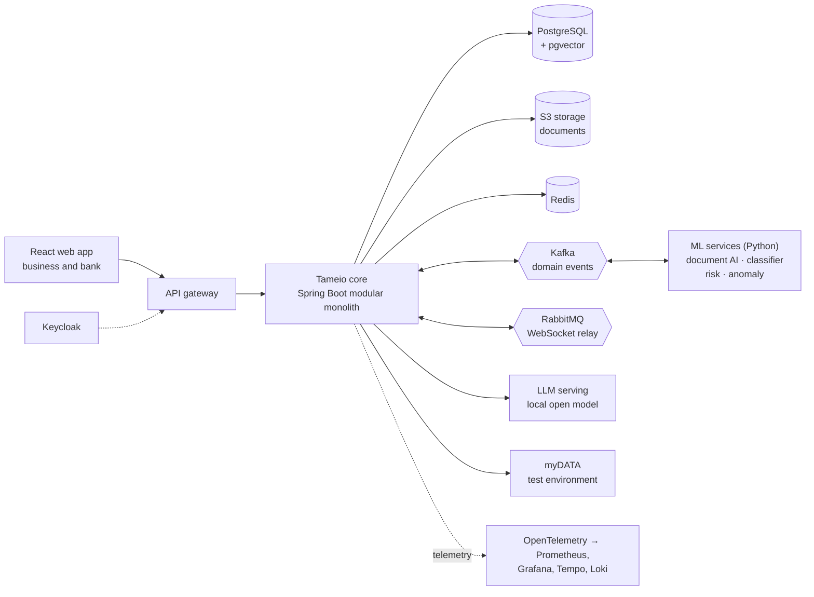

# Tameio: design

Status: draft · Owner: edisban · Last updated: 2026-11-16

Tameio (Greek for "till" or "treasury") is a finance platform for Greek small businesses with a lending
service for banks built on top. A business uses it every day to keep its books: it uploads receipts and
invoices, which AI reads and classifies, and it stays in sync with myDATA, the tax authority's electronic
books. When the business needs a loan, it applies with that same verified data in one step, and the bank
reviews the application with AI assistance and a human decision.

This document describes what we are building, how it fits together and in what order. Decisions with
lasting consequences are recorded as ADRs in [adr/](adr/).

> Tameio is a portfolio project. It runs against the myDATA test environment, with synthetic and public
> data and a fictional bank. It is not financial or accounting advice and does not handle real customers.

## 1. Problem

Small businesses are the large majority of Greek companies, yet two everyday jobs are slow for them:

- **Bookkeeping.** Every received invoice must be recorded and given an expense classification in myDATA.
  Owners and their accountants do this by hand, hundreds of documents a month.
- **Borrowing.** A loan application means gathering documents, retyping figures and waiting weeks, often
  without knowing where the application stands or why it was declined. For a bank, a small loan costs
  almost as much staff time to assess as a large one, so small businesses are often underserved.

Both problems come down to the same thing: financial documents that people read and retype by hand, and
figures that are hard to trust without checking them against an official source.

## 2. Goals and non-goals

Goals:

1. Read business documents (PDFs and photos) and turn them into checked, structured data.
2. Keep a business's books in sync with myDATA and suggest the expense classification for each invoice.
3. Let a business apply for a loan with data it has already verified, and follow the application live.
4. Give bank staff one place to assess an application: the documents, a comparison with myDATA, an
   explained risk score, fraud checks and an AI summary, with a human making every decision.
5. Build it the way large companies build such systems, and show the engineering behind each AI model:
   a baseline, a measured improvement, and monitoring once it runs.

Non-goals:

- Being a certified e-invoicing provider, a real bank, or a replacement for an accountant.
- Core banking (accounts, payments, loan servicing after approval). It is mocked where needed.
- Real personal or banking data. Only synthetic data, public datasets and the founder's own documents.

## 3. Users and roles

| Role | Side | Can do |
| --- | --- | --- |
| Business owner | Business | Upload documents, review classifications, issue invoices, apply for loans |
| Accountant | Business | Everything above for each business that invites them |
| Credit analyst | Bank | Review applications, request documents, recommend a decision |
| Credit manager | Bank | Approve or decline; second approval above the analyst's limit |
| Administrator | Bank | Users and roles, approval limits, AI model versions, audit log |

Every business is a separate tenant: its data is never visible to another business. Bank staff see only
applications submitted to the bank, never a business's day-to-day books.

## 4. Key journeys

**Daily bookkeeping.** The owner photographs a receipt. Document AI finds the issuer, VAT number (ΑΦΜ),
date, totals and QR code, reads them, and checks them: a valid ΑΦΜ, net plus VAT equal to the total. The
document is matched to the invoice in myDATA through its MARK number. The expense classifier suggests a
classification; the owner or accountant accepts or corrects it, and Tameio sends it to myDATA. Every
correction becomes training data.

**Loan application.** The owner presses "Apply with my data": the application is filled from the books
and myDATA, and the owner adds the purpose, amount and any extra documents. Identity is verified from a
photo of the ID card. A voice assistant answers questions and helps fill in what is missing. The owner
follows the application's progress live.

**Assessment and decision.** The analyst opens the case: documents with what the AI read drawn over them,
declared figures next to myDATA's, a risk score with the factors behind it, fraud checks and an AI summary
that cites its sources. The analyst recommends a decision; above the approval limit a manager must approve
as well (maker-checker). Every view and action is written to the audit log.

## 5. Architecture

### 5.1 Core: a modular monolith

The core is one Spring Boot application split into modules with clear boundaries
([ADR 0001](adr/0001-modular-monolith-first.md)). Modules talk through their public interfaces and domain
events, never each other's tables, so any of them can become a separate service later if load or team
structure calls for it.

| Module | Owns |
| --- | --- |
| `identity` | Tenants, memberships and roles on top of Keycloak |
| `documents` | Uploads, storage, processing status, extracted fields and human review |
| `accounting` | Invoices, expense classifications, the ledger, VAT summaries, cash-flow forecast |
| `mydata` | The myDATA integration: fetching, sending, matching, credentials, retries |
| `lending` | Applications, the workflow, assessments, approvals |
| `assistant` | The customer voice assistant and the analyst assistant: retrieval and tool calling |
| `notifications` | Live updates to users over WebSocket |
| `audit` | An append-only record of who saw and did what |

### 5.2 ML services

Models run in Python services behind small FastAPI APIs ([ADR 0002](adr/0002-java-core-python-ml.md)). The
core never calls a model inline for long work: it publishes an event (`document.uploaded`) and the ML
service answers with another (`document.extracted`). Short, user-facing calls (a classification
suggestion) go over HTTP with a timeout and a fallback.

### 5.3 Messaging

- **Kafka** carries domain events between modules and the ML services. Events are durable and replayable,
  so a model can be re-run over past documents ([ADR 0003](adr/0003-kafka-events-rabbitmq-websockets.md)).
- **RabbitMQ** relays STOMP WebSocket messages, so live updates reach a user whichever instance they are
  connected to.

### 5.4 Running at scale

The core is stateless: identity comes from tokens, shared state lives in PostgreSQL and Redis, and
WebSocket fan-out goes through RabbitMQ. It therefore runs as several identical instances behind a load
balancer that routes only to instances whose Actuator health and readiness checks pass. In Kubernetes,
replicas scale with load. k6 load tests show the effect in Grafana.

## 6. Data model (first cut)

| Entity | Notes |
| --- | --- |
| `tenant` | A business, keyed by its ΑΦΜ |
| `membership` | A user's role in a tenant or in the bank |
| `document` | File in S3 storage, type, processing status, page count |
| `extracted_field` | Name, value, confidence, bounding box, source (model or person) |
| `invoice` | Issuer, recipient, dates, net, VAT, total, MARK, origin (myDATA or document) |
| `expense_classification` | Suggested and final category, model version, who confirmed it |
| `loan_application` | Amount, term, purpose, status, workflow state |
| `credit_assessment` | Score, model version, factor contributions, created at |
| `risk_alert` | Type, severity, evidence, status |
| `approval` | Who decided what, at which level, with which comment |
| `audit_event` | Actor, action, subject, time; append-only |
| `model_version` | Model name, version, metrics, when it went live |

Every business table carries `tenant_id`, and PostgreSQL row-level security enforces it as a second line
of defence behind the application's own checks. Money is `numeric` in the database and `BigDecimal` in
Java.

## 7. Domain events

| Event | Published by | Consumed by |
| --- | --- | --- |
| `document.uploaded` | documents | document AI |
| `document.extracted` | document AI | documents, accounting |
| `invoice.recorded` | accounting | classifier, anomaly detection, mydata |
| `classification.confirmed` | accounting | mydata, training data store |
| `mydata.synced` | mydata | accounting |
| `application.submitted` | lending | risk, anomaly detection, notifications |
| `assessment.completed` | risk | lending, notifications |
| `decision.made` | lending | notifications, audit |

## 8. AI and ML

Each model starts from a simple baseline, and replaces it only if it is measurably better on a held-out
test set. Every model has a model card: data, metrics, known limits.

| Capability | Approach | Baseline | Measured by |
| --- | --- | --- | --- |
| Document layout | YOLO fine-tuned to find issuer, ΑΦΜ, date, line items, totals, QR, signature, stamp | Fixed regions per template | mAP@0.5 |
| Reading fields | OCR on each detected region, then validation rules | OCR on the whole page | Field-level accuracy |
| End-to-end extraction | LayoutLMv3 or Donut, compared with YOLO + OCR | — | Field accuracy, latency |
| Expense classification | Greek BERT fine-tuned on confirmed classifications | TF-IDF + logistic regression | Macro F1 |
| Identity documents | YOLO for ID card fields, OCR, consistency checks | — | Field accuracy |
| Credit risk | Gradient boosting with SHAP explanations | Logistic regression | ROC-AUC, calibration, fairness by region and sector |
| Fraud and AML | Isolation Forest on invoices; payment-graph features for circular flows | Rules | Precision at top-k |
| Cash-flow forecast | Gradient boosting on lagged features | Seasonal naive | MAPE |
| Assistants | Local open LLM with retrieval (pgvector) and tool calling, PII redacted first | Larger hosted model | Answer accuracy on a golden set, cost, latency |
| Voice | Speech-to-text and text-to-speech in Greek | — | Word error rate |

MLOps:

- Experiments and the model registry in MLflow; training data versioned with DVC.
- Corrections from people (fields, classifications) are stored as labelled data and feed retraining.
- Low-confidence documents go to a review queue first (active learning).
- A new model version goes live only if CI shows it is at least as good as the current one on the test set.
- Input drift and live accuracy are monitored and shown in Grafana.
- Models are exported to ONNX and quantised where that keeps accuracy, so they run fast on CPU.

Responsible AI: credit scoring is a high-risk use under the EU AI Act. Tameio therefore explains every
score, keeps a person in charge of every decision, logs inputs, outputs and model versions, and checks
the credit model for unequal outcomes between groups ([ADR 0005](adr/0005-human-decides-every-credit-decision.md)).

## 9. myDATA integration

- Runs against the myDATA test environment only, with the test credentials of the business.
- Operations: fetch invoices issued to the business, send expense and income classifications, issue
  invoices, look up an invoice by MARK.
- Credentials are encrypted at rest and never logged. Calls go through Resilience4j (timeouts, retries
  with backoff, circuit breaker) and are idempotent, so a retry never sends an invoice twice.
- Requests and responses are XML, validated against the published schemas.

## 10. Security and compliance

- Sign-in with Keycloak (OpenID Connect); roles and tenant come from the token.
- Tenant isolation in the application and in the database (row-level security).
- Secrets in Vault; documents encrypted at rest in S3 storage; TLS everywhere outside local development.
- An append-only audit log for every view of a case and every decision.
- Personal data is redacted before any text reaches an LLM; the LLM runs locally, so no customer data
  leaves the platform.
- Data export and deletion on request (GDPR).
- Dependencies and images scanned in CI (Trivy, OWASP); code quality in SonarQube.

## 11. Observability

OpenTelemetry instruments the core and the ML services. Metrics go to Prometheus, traces to Tempo and
logs to Loki, all in Grafana. A single document can be followed from upload through Kafka and the ML
services to the analyst's screen. Dashboards cover request rates and latency, queue lag, myDATA errors and
model health.

## 12. Testing

| Level | Tools |
| --- | --- |
| Unit | JUnit 5, pytest |
| Integration | Testcontainers (PostgreSQL, S3 storage, Kafka, RabbitMQ, Keycloak) |
| Contracts between core and ML services | Spring Cloud Contract or Pact |
| End to end | Playwright |
| Load | k6 |
| Models | Evaluation on held-out sets as a CI quality gate |

## 13. Delivery plan

Each phase ends with something that runs and can be demonstrated.

| Phase | Scope | Done when |
| --- | --- | --- |
| 0 | This design, first ADRs, repository and CI skeleton | Reviewed and pushed |
| 1 | Core skeleton: Keycloak, tenants, document upload to S3 storage, React app | A business signs in and uploads a document |
| 2 | Document AI v1: OCR, validation rules, baseline expense classifier | Fields and a classification appear for a receipt |
| 3 | YOLO fine-tuning and the review screen with boxes over the document | mAP reported; corrections saved as training data |
| 4 | myDATA: fetch, classify, issue, match by MARK, with Resilience4j | Round trip against the test environment |
| 5 | Lending: applications, workflow, maker-checker, back office | An application goes from submission to decision |
| 6 | Risk: credit model with SHAP, fraud checks, model cards | Scores with explanations in the case file |
| 7 | Scale: Kafka, RabbitMQ relay, gateway, several instances, OpenTelemetry, Grafana, k6 | Load test results on a dashboard |
| 8 | Assistants: retrieval, tool calling, voice, PII redaction | Customer and analyst assistants work end to end |
| 9 | MLOps: MLflow, retraining from corrections, drift monitoring, quality gates | A retrained model is promoted by CI |
| 10 | Kubernetes with Helm, security scanning, SonarQube | The stack runs on a local cluster |

## 14. Open questions

- Exact myDATA endpoints, schemas and limits: to confirm against the AADE documentation before phase 4.
- Which open LLM runs well enough in Greek on available hardware (CPU or a single GPU).
- Labelled Greek receipts and invoices for YOLO: how many we can collect and annotate ourselves.
- Public credit and fraud datasets to use, and how to adapt them to small Greek businesses.
