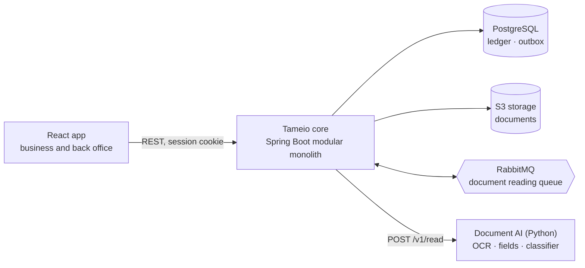

# Tameio: design

Status: living document · Owner: edisban · Last updated: 2026-11-21

Tameio (Greek for "till" or "treasury") is a small bank for Greek small businesses, with their books
built in. A business holds its money in current accounts, uploads its receipts and invoices, which AI
reads and classifies into an expense book, and borrows from the bank with the figures it has already
verified. Bank staff work in a back office: customer accounts, the general ledger, staff and, soon, loan
applications.

This document describes what is built, how it fits together and what comes next. Decisions with lasting
consequences are recorded as ADRs in [adr/](adr/).

> Tameio is a portfolio project. Every person, business, account movement, document and loan in it is
> invented by the demo data loader. It is not a real bank and holds no real money.

## 1. Problem

Small businesses are the large majority of Greek companies, yet two everyday jobs are slow for them:

- **Bookkeeping.** Every received invoice must be recorded and given an expense category. Owners and
  their accountants do this by hand, hundreds of documents a month.
- **Borrowing.** A loan application means gathering documents, retyping figures and waiting weeks, often
  without knowing where the application stands. For a bank, a small loan costs almost as much staff time
  to assess as a large one, so small businesses are often underserved.

Both come down to the same thing: figures that people retype by hand and that are hard to trust.

## 2. Goals and non-goals

Goals:

1. Read business documents (PDFs and photos) and turn them into checked, structured data.
2. Keep a business's expense book and VAT from the documents it confirms.
3. Hold the business's money on a ledger that never loses or invents a cent.
4. Let a business apply for a loan with data it has already verified; give bank staff one place to assess
   it, with an explained risk score and a person making every decision.
5. Show the engineering: tests at every level, decisions written down, and failure handled on purpose.

Non-goals:

- Being a real bank, a certified e-invoicing provider, or a replacement for an accountant.
- Real people, real money or real documents: all data comes from the demo data loader.
- Payments between accounts or to other banks: money arrives as demo deposits and the demo history.

## 3. Users and roles

| Role | Side | Can do |
| --- | --- | --- |
| Business owner | Business | Open accounts, upload and confirm documents, see the books, apply for loans |
| Credit analyst | Bank | See customer accounts; review applications and recommend a decision |
| Credit manager | Bank | Freeze accounts; decide applications up to their approval limit |
| Administrator | Bank | Everything in the back office: staff, roles, approval limits, the general ledger, the audit log |

Every business is a separate tenant: its data is never visible to another business.

## 4. Key journeys

**Daily bookkeeping.** The owner uploads a receipt. Document AI reads the issuer's ΑΦΜ, the date, net,
VAT and total, checks them (a valid ΑΦΜ, net plus VAT equal to the total) and suggests an expense
category. The owner confirms or corrects it on a screen that shows the document beside the fields; the
confirmed values go into the expense book, and every correction is kept as training data.

**Loan application** (next). The owner applies with the amount, term and purpose; the application is
filled in from the books and the account's history. An analyst reviews it with a simple, explained risk
score and recommends; a manager whose approval limit covers the amount decides, and can never be the
person who recommended. An approved loan is paid into the business's account through the ledger.

## 5. Architecture

### 5.1 Core: a modular monolith

One Spring Boot application split into modules with clear boundaries
([ADR 0001](adr/0001-modular-monolith-first.md)). Modules talk through their public types and domain
events, never each other's tables; Spring Modulith checks this in a test.

| Module | Owns | Status |
| --- | --- | --- |
| `identity` | User accounts and sign-in, staff and approval limits, businesses and memberships | Built |
| `documents` | Uploads, storage, reading by document AI, extracted fields, human review | Built |
| `accounting` | The expense book, totals by month, quarter and category, CSV export | Built |
| `banking` | Current accounts with IBANs, the double-entry ledger, the trial balance | Built |
| `lending` | Loan applications, the review workflow, decisions, disbursement | Next |
| `audit` | An append-only record of who did what | Planned |
| `platform` | Security, errors, persistence, storage, validation, demo data plan (shared, not a business module) | Built |

### 5.2 Document AI

Models run in a Python service behind a small FastAPI API ([ADR 0002](adr/0002-java-core-python-ml.md)).
The core never calls it inside a user's request: an upload becomes a job on a RabbitMQ queue, and a
consumer in the core calls the service over HTTP with a timeout
([ADR 0008](adr/0008-rabbitmq-work-queue-for-document-reading.md)).

### 5.3 Messaging

- **In-process domain events** connect modules: `DocumentReviewed` from documents fills the expense book
  in accounting through an asynchronous, durable module listener.
- **RabbitMQ** carries the one piece of work that leaves the process: reading documents. Jobs come from a
  transactional outbox (Spring Modulith's event publication registry), so a job is sent only after the
  upload commits and never lost; failures are retried with back-off and then dead-lettered.
- **No Kafka.** It was planned for replayable events ([ADR 0003](adr/0003-kafka-events-rabbitmq-websockets.md),
  superseded); nothing in the app needs replay yet.

### 5.4 Several instances

The core keeps no session state: identity comes from signed tokens, and everything shared lives in
PostgreSQL and RabbitMQ. Running several instances behind a load balancer is the subject of the
observability and load-balancing phase (section 12), including what breaks and how it is handled.

## 6. Data model

| Table | Module | Notes |
| --- | --- | --- |
| `user_account` | identity | Email, Argon2id hash, role, session version, approval limit |
| `business`, `membership` | identity | A business keyed by its ΑΦΜ, and who acts for it |
| `document`, `document_check`, `document_correction` | documents | The file's details, what was read, checks, corrections |
| `expense` | accounting | One entry per confirmed document |
| `bank_account` | banking | Customer and internal accounts, balance, status |
| `journal_entry`, `posting` | banking | Append-only double-entry ledger; every entry sums to zero |
| `event_publication` | platform | The outbox |

Money is `numeric` in the database and `BigDecimal` in Java; schema changes are Flyway migrations, and an
applied migration is never edited.

## 7. Domain events

| Event | Published by | Consumed by |
| --- | --- | --- |
| `DocumentUploaded` | documents | the reading queue (RabbitMQ, through the outbox) |
| `DocumentReadRequested` | documents | the reading queue |
| `DocumentReviewed` | documents | accounting |
| `AccountTransactionBooked` | banking | nothing yet; lending and the overview will |
| `DemoBusinessReady` | identity | banking and accounting, to build a demo business's year |

## 8. AI and ML

Each model starts from a simple, measured baseline.

| Capability | Approach | Measured by |
| --- | --- | --- |
| Reading fields | Tesseract OCR (Greek), then rules with a confidence per field and consistency checks | Field-level tests on real OCR |
| Expense classification | TF-IDF + logistic regression | Macro F1 on shops never seen in training; CI fails if it drops |
| Credit risk (next) | A few explained rules or a logistic regression on the demo data | Every factor shown to the analyst |

Credit scoring is a high-risk use under the EU AI Act: the score is explained, and a person makes every
decision ([ADR 0005](adr/0005-human-decides-every-credit-decision.md)).

## 9. Security

- Sign-in inside the core: Argon2id password hashes, a signed session token in an HttpOnly cookie, CSRF
  protection and account lock-out ([ADR 0007](adr/0007-sign-in-inside-the-core.md)).
- Every token carries the account's session version: disabling an account, resetting its password or
  changing its role ends its sessions at once.
- Staff accounts are created by an administrator with a temporary password that must be replaced.
- Tenant isolation: every query checks membership, and another business's data answers 404.
- The ledger is append-only and balanced by database triggers, not only by code.

## 10. Testing

| Level | Tools |
| --- | --- |
| Unit and API | JUnit 5, MockMvc, Testcontainers (PostgreSQL, RabbitMQ, S3 storage), JaCoCo (80% floor) |
| Module boundaries | Spring Modulith verification |
| Frontend components | Vitest, Testing Library, MSW |
| End to end | Playwright against the whole stack |
| Document AI | pytest with real OCR; the classifier's macro F1 as a quality gate |
| Load (planned) | k6 |

## 11. Known trade-offs

- **Hot internal accounts.** Every movement in or out of the bank books against one internal account
  (`SETTLEMENT`; loans will use `LOANS`), and the ledger locks every account an entry touches. Movements
  therefore queue on that one row. At this scale, a few milliseconds each, it is fine. At bank scale one
  would split the hot account into several sub-accounts booked in turn, or keep its balance as a sum of
  postings computed when needed instead of a locked running total.
- **One database.** The ledger, the outbox and the books share one PostgreSQL. That keeps every booking
  and its event in one transaction; splitting it would need a distributed protocol the app does not need.
- **Polling, not push.** Pages ask again while a document is being read. A WebSocket channel would be
  nicer and is not worth its moving parts yet.

## 12. Delivery plan

| Phase | Scope | Status |
| --- | --- | --- |
| 0 | Design, ADRs, repository and CI | Done |
| 1 | Sign-in, businesses, document upload to S3 storage, React app | Done |
| 2 | Document AI: OCR, rules, classifier, reading queue, review screen | Done |
| 3 | Accounting: expense book, VAT by quarter, CSV | Done |
| 4 | Bank staff, roles, approval limits, session revocation | Done |
| 5 | Core banking: accounts, double-entry ledger, trial balance, demo data | Done |
| 6 | Lending: applications, state machine, maker-checker, explained risk score, disbursement | Next |
| 7 | Audit log: append-only, filled from domain events, admin search | Planned |
| 8 | Observability and load balancing: Prometheus, Grafana, three instances behind nginx, k6 | Planned |

## 13. Later ideas

Not planned for now; recorded so the direction is clear.

- Payments: transfers between accounts and SEPA credit transfers to other banks.
- myDATA (the tax authority's electronic books): fetching, classifying and issuing invoices.
- Document AI: YOLO fine-tuning for field boxes, LayoutLM or Donut, a Greek BERT classifier, MLflow and
  DVC for experiments and data.
- Assistants: a local LLM with retrieval, voice in Greek.
- Risk: gradient boosting with SHAP, fraud detection on a payment graph, a cash-flow forecast.
- Platform: Kafka for replayable events, Redis, Vault for secrets, Kubernetes with Helm, contract tests
  with Pact, WebSocket notifications.
